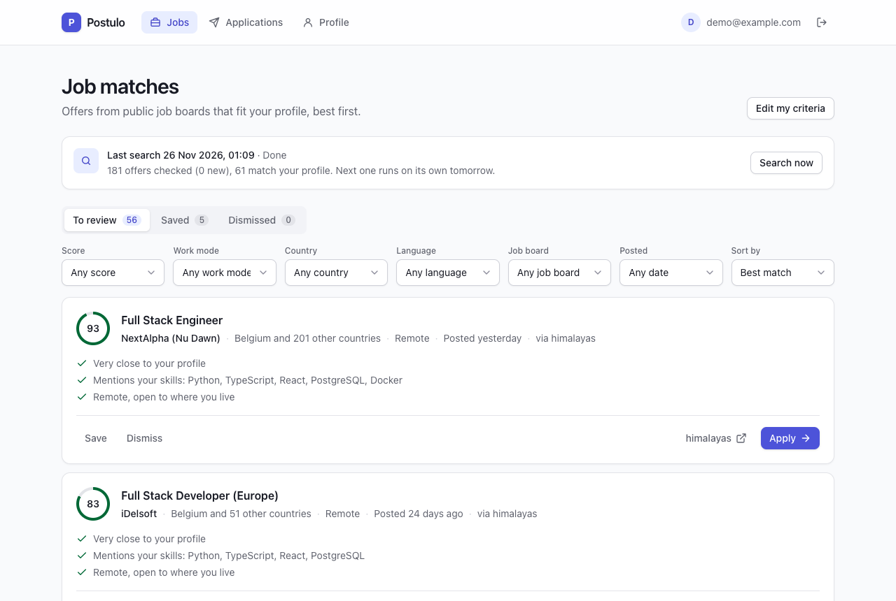
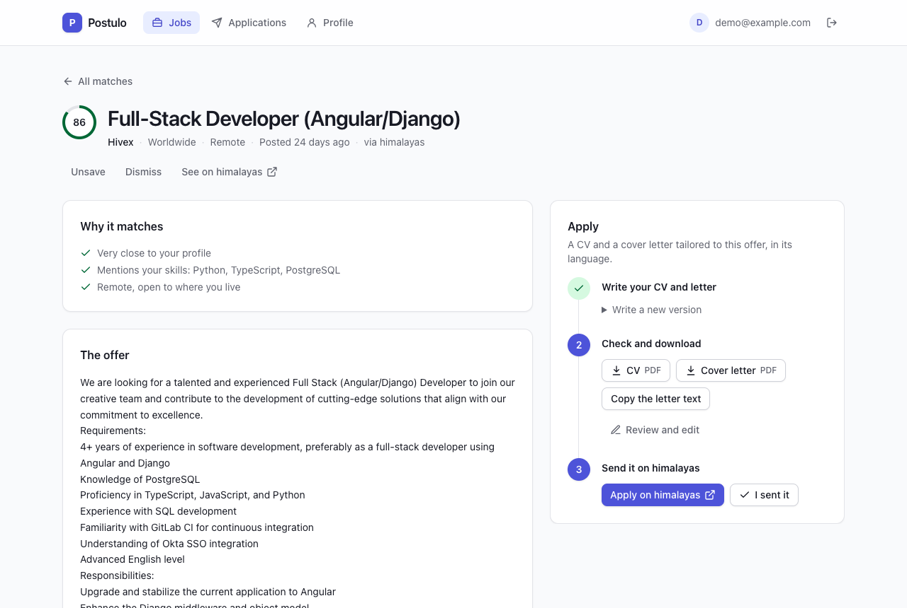
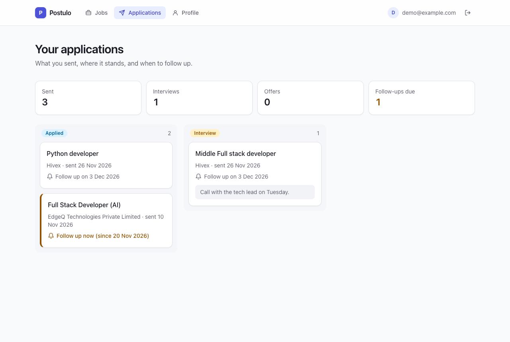
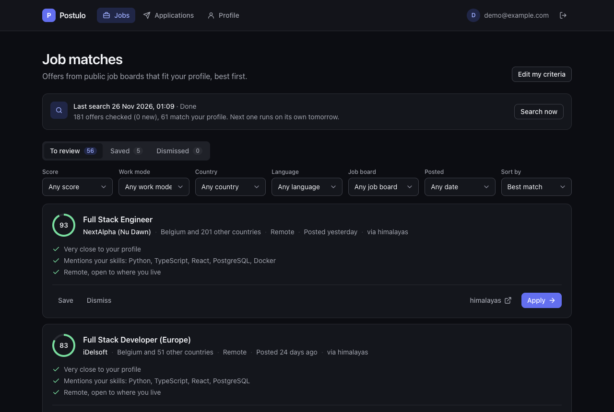
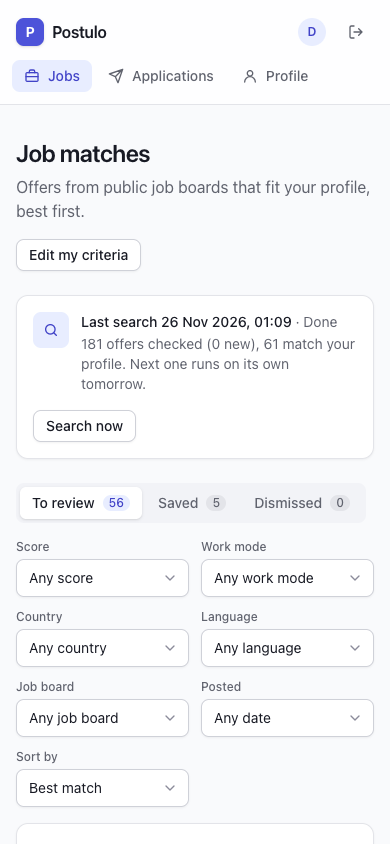

# Postulo

AI-assisted job search app: job offer collection, scoring, CV and cover letter generation, application tracking



| Apply in three steps | Follow every application |
| --- | --- |
|  |  |
| **Dark mode** | **Mobile** |
|  |  |

## Stack

| Part | Technology |
| --- | --- |
| API | [FastAPI](https://fastapi.tiangolo.com), Python 3.15, [uv](https://docs.astral.sh/uv/), SQLAlchemy 2, Alembic, Pydantic Settings |
| Web | [Next.js](https://nextjs.org) 16 (App Router), React 19, TypeScript, Tailwind CSS 4 |
| Database | PostgreSQL 18 with [pgvector](https://github.com/pgvector/pgvector) |
| Auth | Email + password (Argon2), JWT access tokens, httpOnly session cookie |
| Tooling | Docker Compose, Make, Ruff, mypy, pytest, ESLint, Prettier, pre-commit, GitHub Actions |

## Quick start

Prerequisites: [Docker](https://docs.docker.com/get-started/get-docker/) (running), [uv](https://docs.astral.sh/uv/getting-started/installation/), [Node.js](https://nodejs.org) 26+ and `make`.

```bash
make setup
```

This checks the prerequisites, creates `.env` with freshly generated secrets, installs the dependencies and git hooks, and starts the stack. Then open:

- Frontend: http://localhost:3000
- API docs (Swagger UI): http://localhost:8000/docs

Run `make` to list every command.

## Daily commands

| Command | What it does |
| --- | --- |
| `make dev` | Start everything with hot reload, logs in the foreground |
| `make up` / `make down` | Start the stack in the background / stop it (data is kept) |
| `make check` | Lint, format check, type check and tests, for the API and the web app |
| `make fix` | Auto-fix lint and formatting issues |
| `make test` | Run the API tests (starts the database if needed) |
| `make migration m="..."` | Create a database migration from your model changes |
| `make migrate` | Apply the pending migrations |
| `make api-types` | Regenerate the frontend's typed API client after changing the API |
| `make create-user email=...` | Create an account from the command line |
| `make db-shell` | Open a `psql` console |

## Project structure

```
.
├── apps/
│   ├── api/                 FastAPI backend
│   │   ├── app/
│   │   │   ├── core/        settings, database session, security, dependencies
│   │   │   ├── models/      SQLAlchemy models (database tables)
│   │   │   ├── schemas/     Pydantic models (request and response bodies)
│   │   │   ├── services/    business logic, called by the routes
│   │   │   ├── routes/      HTTP endpoints
│   │   │   └── main.py      app creation, middleware, routers
│   │   ├── migrations/      Alembic migrations
│   │   ├── scripts/         command-line helpers (OpenAPI export, create user)
│   │   └── tests/           pytest, mirrors app/
│   └── web/                 Next.js frontend
│       └── src/
│           ├── app/         routes (pages, layouts, server actions)
│           ├── components/  React components
│           └── lib/         API client, session helpers, site constants
├── scripts/                 setup and .env generation
├── compose.yaml             the stack (db, migrate, api, web)
├── compose.override.yaml    development settings (hot reload)
└── Makefile                 every day commands
```

## How it works

### Authentication

1. The browser only talks to the Next.js server. Login and sign-up forms post to [server actions](apps/web/src/app/(auth)/actions.ts).
2. The server action calls `POST /auth/login` on the API, which checks the password (hashed with Argon2) and returns a signed JWT.
3. Next.js stores the token in an **httpOnly, SameSite=Lax** cookie (Secure in production): client-side JavaScript can never read it, which protects it against XSS.
4. Server components read the cookie and call the API with `Authorization: Bearer <token>` ([session.ts](apps/web/src/lib/auth/session.ts)). The API validates the token on every request.

The API also works on its own: use the **Authorize** button in the API docs, or any HTTP client.

### Typed API client

The API publishes an OpenAPI schema. `make api-types` turns it into TypeScript types ([schema.d.ts](apps/web/src/lib/api/schema.d.ts)) used by [openapi-fetch](https://openapi-ts.dev/openapi-fetch/): paths, parameters and responses are all checked by the compiler. CI fails if you change the API without regenerating the types.

### Database and migrations

Models live in `apps/api/app/models/`. After changing one, run `make migration m="describe the change"`, review the generated file in `apps/api/migrations/versions/`, then `make migrate`. In Docker, the one-off `migrate` service applies pending migrations before the API starts. A test fails if the models and the migrations disagree.

### Job search worker

The `worker` service ([app/worker.py](apps/api/app/worker.py)) runs the job searches, so the API never waits for a job board:

1. Once a day per user (or when the user clicks **Search now** on `/jobs`), a row is queued in `job_search_runs`. The table is the queue: no message broker.
2. The worker collects offers from free public job boards: [Remotive](https://remotive.com), [Jobicy](https://jobicy.com) and [Himalayas](https://himalayas.app) (remote jobs, no key), plus [Adzuna](https://developer.adzuna.com) (on-site jobs in Belgium and elsewhere) when `ADZUNA_APP_ID` and `ADZUNA_APP_KEY` are set (free keys).
3. Each new offer gets an embedding from a local, free model ([model2vec](https://github.com/MinishLab/model2vec), multilingual, downloaded once into the `models` volume) stored in a pgvector column.
4. pgvector finds the offers closest in meaning to the profile; the worker keeps those that fit the search criteria (countries, work modes, remote abroad, offer languages) and saves them in `job_matches` with a 0-100 score.


API tests run against a real PostgreSQL database (`<POSTGRES_DB>_test`), recreated and migrated at the start of each run. Every test runs in a transaction that is rolled back, so tests stay independent. `make test` starts the database container if needed.

### Configuration

Everything is configured with environment variables, read from `.env` locally and passed by Docker Compose in containers. See [.env.example](.env.example). The API refuses to start if a required value is missing or a secret is too short.

## Working with Claude Code

This project is ready for [Claude Code](https://claude.com/claude-code):

- [CLAUDE.md](CLAUDE.md) explains the architecture, commands and conventions, so Claude follows the project's patterns from the first prompt.
- [.claude/settings.json](.claude/settings.json) pre-approves the safe project commands (`make check`, `uv run ...`, `npm run ...`) and blocks reading `.env`.
- [.claude/skills/](.claude/skills/) contains step-by-step skills, for example `add-feature` to add a resource end to end (model, migration, API, tests, typed client, page).
- The AI features also work for free with your Claude plan, without an API key: `/import-cv <pdf>` fills the profile from a CV, and `/tailor-application <match id>` writes a CV and a cover letter for one offer (the offer's Apply panel shows the exact command). Both copy a JSON result that you paste into the app.

Try: *"Add a notes feature: users can create, list and delete their own notes."*

## Deployment

The production stack lives in [compose.prod.yaml](compose.prod.yaml): Caddy serves the app over HTTPS (automatic Let's Encrypt certificates) and is the only service with published ports; the API and the database stay on the internal network. Containers are read-only, without Linux capabilities, with health checks and JSON logs.

```bash
make prod-env   # creates .env.prod with fresh secrets: set DOMAIN in it
make prod-up    # builds and starts the stack
make backup     # dumps the database into backups/ (restore with make restore file=...)
```

[DEPLOY.md](DEPLOY.md) covers the hosting options (free and cheap), the server setup, backups, updates and what to check before opening the app to other users.

## Troubleshooting

- **A port is already in use**: change `POSTGRES_PORT`, `API_PORT` or `WEB_PORT` in `.env`, then `make up`.
- **Docker Desktop freezes or a container cannot be stopped (macOS)**: hot reload uses Compose Watch, which copies files into containers instead of bind-mounting folders, to avoid this. If it still happens, restart Docker Desktop, update it, and try another file sharing implementation in *Settings > General*.
- **`localhost` does not resolve**: check that `/etc/hosts` contains `127.0.0.1 localhost` and `::1 localhost`.
- **The API container exits at startup**: read `make logs`; a missing or invalid setting is reported by name.

## License

MIT, see [LICENSE](LICENSE).
